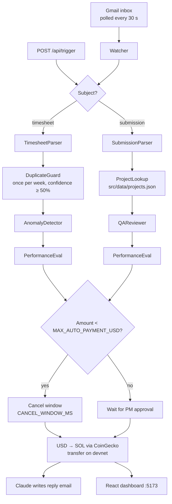

# PayrollBot

An autonomous AI payroll agent for teams that pay freelancers: it reads timesheet and project-submission emails from Gmail, checks them with Claude, and pays out in SOL on Solana devnet — with a human approval gate for anything large.

Built at the [Startit.rs Money Agent Hackathon](https://startit.rs).


<!-- screenshot: add docs/screenshot.png -->

## Features

- **Reads your inbox** — polls Gmail for unread emails whose subject contains `timesheet` or `submission`.
- **Timesheets** — Claude extracts hours, rate and wallet, flags anomalies (> 60 h/week, rate off > 20 % from history, total > $5,000), then pays.
- **Project submissions** — Claude reviews the delivery against the project's requirements and pays a partial or full share of the agreed budget.
- **Human in the loop** — small payments get a 2-minute cancel window; large ones wait for explicit PM approval in the dashboard.
- **Performance-aware** — a bonus/penalty multiplier between 0.85× and 1.15× based on signals in the email.
- **Explains itself** — every agent step logs its reasoning; freelancers get a personalised reply email with an explorer link.

## How it works



Unclear or incomplete emails don't get paid — the agent replies asking the freelancer for the missing details. A 0.5 % agent fee is split off each payment and sent to `AGENT_WALLET` if one is set. Every Monday at 9:00 a Claude-written digest goes to `PM_EMAIL`.

## Quickstart

Prerequisites: Node.js 18+, an Anthropic API key, a funded Solana **devnet** wallet, and a Gmail OAuth access token.

```bash
git clone https://github.com/0jz/payrollbot.git
cd payrollbot
npm install
cp .env.example .env      # fill in ANTHROPIC_API_KEY, SOLANA_PRIVATE_KEY, GMAIL_ACCESS_TOKEN
node get-pubkey.js        # prints the payer address — fund it at https://faucet.solana.com
npm run dev               # agent API on :3001 + dashboard on :5173
```

<details>
<summary>Getting the keys</summary>

**Solana devnet wallet** — with the Solana CLI: `solana-keygen new`, then `solana airdrop 2 <your-pubkey> --url devnet`. `SOLANA_PRIVATE_KEY` accepts either a base58 secret key or the JSON byte array from the keypair file.

**Gmail token** — in Google Cloud Console create a project, enable the Gmail API and create OAuth credentials; then use the [OAuth Playground](https://developers.google.com/oauthplayground) to get an access token with scope `https://www.googleapis.com/auth/gmail.modify`. Access tokens expire after about an hour; there is no refresh logic yet.

</details>

## Configuration

| Variable | Required | Default | Description |
|---|---|---|---|
| `ANTHROPIC_API_KEY` | Yes | — | Anthropic API key used by every agent. |
| `SOLANA_PRIVATE_KEY` | Yes | — | Payer wallet secret (base58 or JSON array). **Secret.** |
| `GMAIL_ACCESS_TOKEN` | Yes | — | Gmail OAuth2 bearer token (read inbox, send replies). |
| `PM_EMAIL` | No | — | Receives approval requests and the weekly digest. |
| `MAX_AUTO_PAYMENT_USD` | No | `500` | Below this: auto-pay after cancel window. At/above: PM approval required. |
| `CANCEL_WINDOW_MS` | No | `120000` | Delay before an auto-payment executes (2 min). |
| `POLL_INTERVAL_MS` | No | `30000` | Gmail poll interval. |
| `MAX_HOURS_THRESHOLD` | No | `60` | Weekly hours above which a timesheet is flagged. |
| `RATE_DEVIATION_THRESHOLD` | No | `0.20` | Rate deviation from history that triggers a flag (0.20 = 20 %). |
| `AGENT_WALLET` | No | — | Public key that receives the 0.5 % agent fee. Blank = no fee transfer. |

`.env.example` also contains `GMAIL_MCP_URL`; the code doesn't use it (Gmail is called via its REST API).

## Usage

### Try it without email

```bash
curl -X POST http://localhost:3001/api/trigger \
  -H "Content-Type: application/json" \
  -d '{"subject":"timesheet - Test Dev","from":"test@example.com","body":"Worked 20 hours on API project. Rate $50/hr. Wallet: <your-devnet-wallet>"}'
```

### Try it with email

Send a mail to the Gmail account whose token you configured, e.g. subject `timesheet - Ana Petrovic`, body: *"I worked 23 hours this week on the website redesign. My rate is $45/hour. My Solana wallet: `<your-devnet-wallet>`"*. More ready-made cases (flagged, duplicate, partial QA pass…) are in [demo-emails.md](demo-emails.md).

Submissions use the subject `submission - <project-id>`, where the ID matches a key in `src/data/projects.json` (sample projects: `ecommerce-checkout`, `api-backend`, `landing-page`). Each project has `agreedBudget`, `walletAddress` and a list of verifiable `requirements`.

### API (port 3001)

| Method | Path | Description |
|---|---|---|
| `GET` | `/api/transactions` | All processed payments, newest first |
| `GET` | `/api/status` | Totals: processed, approved, flagged, agent earnings |
| `GET` | `/api/projects` | Project database |
| `GET` | `/api/pending` | Payments awaiting approval or in a cancel window |
| `POST` | `/api/approve/:id` | Approve a held payment |
| `POST` | `/api/cancel/:id` | Cancel a payment during its cancel window |
| `POST` | `/api/trigger` | Inject an email `{subject, from, body}` for testing |
| `POST` | `/api/digest/send` | Send the PM digest now |

### Scripts

| Command | What it runs |
|---|---|
| `npm run dev` | Agent + dashboard together (`concurrently`) |
| `npm run agent` | Agent/API only (`src/agent/orchestrator.js`) |
| `npm run frontend` | Dashboard only (Vite, port 5173) |
| `npm run build` | Build the dashboard to `dist/` |

## Project structure

```text
src/agent/orchestrator.js     Entry point: Express API, pipelines, email sending
src/agent/agentPipeline.js    Agent / Pipeline / AgentRouter primitives
src/agent/parser.js           Claude: parse timesheet or submission
src/agent/anomaly.js          Claude: anomaly detection
src/agent/qa.js               Claude: requirement-by-requirement QA review
src/agent/performanceEval.js  Claude: bonus/penalty multiplier
src/agent/approvalGate.js     Cancel window + PM approval
src/agent/emailWriter.js      Claude: reply emails
src/agent/digest.js           Claude: weekly PM digest (Mon 9:00)
src/gmail/watcher.js          Gmail REST poller
src/solana/transfer.js        USD → SOL transfer on devnet, 0.5% fee
src/solana/price.js           CoinGecko SOL/USD price
src/data/projects.json        Project database for submissions
src/frontend/                 React dashboard
get-pubkey.js                 Print the payer wallet's public key
demo-emails.md                Copy-paste test emails
```

## Status & limitations

- **Devnet only** — the RPC URL is hard-coded to `https://api.devnet.solana.com`.
- State (transactions, pending approvals, weekly duplicate history) is **in memory** and is lost on restart.
- Gmail access tokens expire after ~1 hour; there's no refresh-token flow.
- The dashboard calls `http://localhost:3001` directly, so it's meant for local use.
- Hackathon project — not audited; don't point it at real funds.

## License

MIT
